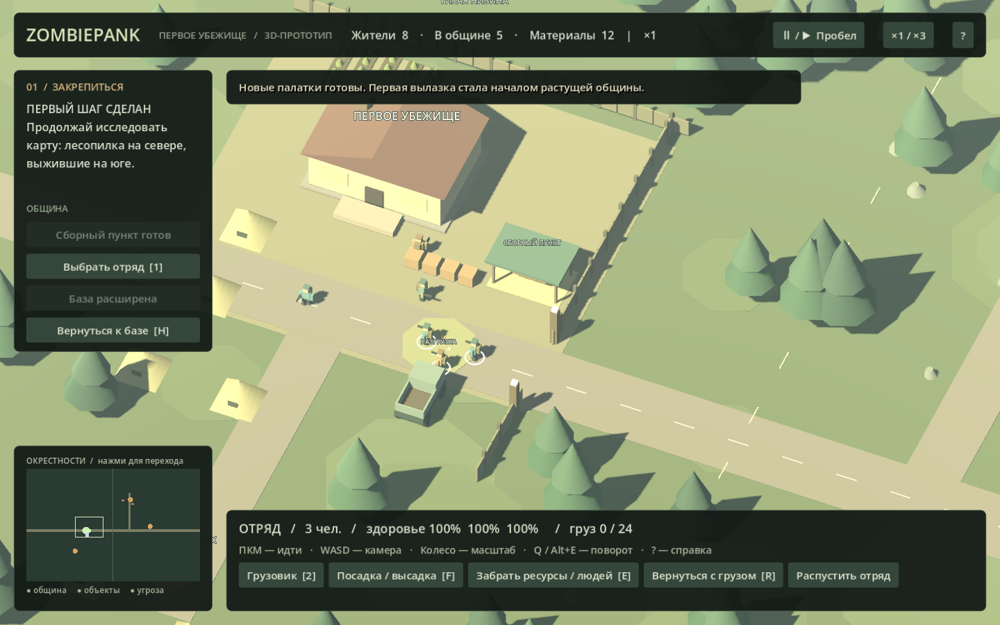

# ZombiePank · Первое убежище

Небольшой рабочий 3D-прототип поселения в зомби-мире. Одна непрерывная карта, дом как начало общины, отряд из тех же жителей и вылазка за материалами. Godot 4.7.2 / GDScript, Windows.



## Запуск

На текущем компьютере: **Play.cmd**. Для редактирования: **Edit.cmd**. На рабочем столе также есть ярлык ZombiePank.

На другой машине: скачать обычную версию [Godot 4.7.2](https://github.com/godotengine/godot/releases/tag/4.7.2-stable), импортировать `project.godot`, нажать F5. .NET не нужен. Внешние библиотеки, ассеты, ключи и подключение к сети для игры не нужны.

## Первая вылазка

1. Построить сборный пункт за 12 материалов (5 секунд).
2. Собрать отряд: трое из восьми жителей покидают хозяйство.
3. ПКМ отправить отряд к заброшенному складу на востоке. Бой с зомби автоматический, дальность стрельбы — 13 метров.
4. Подойти к золотой площадке у склада, нажать E. После зачистки погрузка занимает 4 секунды.
5. Нажать R. Разгрузка происходит автоматически возле домашнего склада.
6. За 24 материала поставить две дополнительные палатки.

Затем можно забрать грузовик, посетить лесопилку и привести четырёх выживших из южного лагеря. Из машины не стреляют: перед боем нужно высадиться. Пеший отряд несёт до 24 материалов, грузовик — до 80. После потерь вместимость пешего отряда уменьшается. Гибель жителя необратима до перезапуска сцены.

## Управление

| Ввод | Действие |
| --- | --- |
| WASD / стрелки | Перемещение камеры |
| Колесо | Масштаб |
| Q / Alt+E | Поворот камеры |
| Средняя кнопка + движение | Перемещение камеры |
| ЛКМ | Выбрать отряд или грузовик |
| ПКМ по земле | Двигаться выбранным отрядом / занятой машиной |
| 1 / 2 | Отряд / грузовик |
| F | Посадка рядом с грузовиком / высадка |
| E | Собрать материалы или пригласить выживших рядом с объектом |
| R | Вернуться на разгрузку |
| H | Камера к базе |
| Пробел | Пауза |
| Esc / ? | Справка |
| F5 | Начать сцену заново |
| Клик по миникарте | Переместить камеру |

## Границы этой версии

Это проба управления и основного цикла, не симулятор тысяч жителей. Восемь жителей и размер карты — параметры тестовой сцены, не принятые ограничения будущей игры. Здесь нет сохранений, смены сезонов, рождения детей, экономики питания, фракций, сценарных экспедиций за край карты и военной техники. Грузовик использует упрощённое движение по сетке без физики вождения и расчёта радиуса поворота. Ресурсы на объектах конечны, толпы и столкновения между бойцами не моделируются. Сцена строится скриптом при запуске; пустой 3D-вид в редакторе до F5 ожидаем.

Все модели процедурные и созданы внутри проекта. Внешних художественных ассетов нет. Стиль и движок могут быть заменены после оценки первой пробы.

## Проверка

```powershell
& "$env:LOCALAPPDATA\Programs\Godot\4.7.2\Godot_v4.7.2-stable_win64_console.exe" --headless --path . -- --smoke-test
& "$env:LOCALAPPDATA\Programs\Godot\4.7.2\Godot_v4.7.2-stable_win64_console.exe" --path . -- --ui-test
```

Первый прогон проверяет строительство, использование работников, бой, добычу, доставку, транспорт, спасение жителей и потери. Второй посылает события мыши и клавиатуры через `Input.parse_input_event` в настоящий viewport Godot, проверяет кнопки, выбор, ПКМ, погрузку, возврат, паузу и миникарту. Это автоматическая проверка ввода движка, а не ручное прохождение человеком. При ошибке оба режима возвращают ненулевой код.

Основные файлы: `scripts/game.gd` — цикл и интерфейс, `scripts/world.gd` — карта и навигация, `scripts/unit.gd` — жители и машина, `scripts/minimap.gd` — миникарта. Решения и план — в `docs/`.
